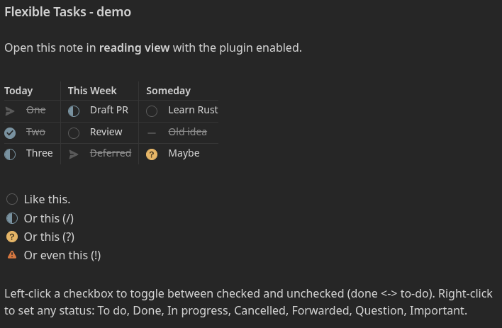
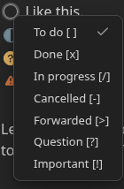

# Flexible Tasks

An [Obsidian](https://obsidian.md) plugin for interactive task checkboxes **inside Markdown table cells** — and custom task statuses everywhere, rendered by your theme.



## Why

A Markdown table cell is inline-only, so a task like `- [ ] One` written in a cell renders as dead text: Obsidian never turns it into a checkbox, and task plugins skip it. Flexible Tasks turns those cell tasks into real, interactive checkboxes and writes toggles back to the source file. It also adds a right-click status menu to ordinary block-list tasks, so you can set any status without retyping the marker.

## Features

- **Checkboxes in table cells** — the thing the Markdown format won't do. Click to toggle, right-click to set any status.
- **Custom statuses** — `[ ]`, `[x]`, `[/]`, `[-]`, `[>]`, `[?]`, `[!]`, and any other single character round-trip faithfully in the source.
- **Table checkboxes in Reading view.** Live Preview uses Obsidian's native table editor.
- **Defers to your theme.** The plugin puts a real checkbox carrying `data-task="<char>"` in place. The theme draws the checkbox and status icon.
- **Off-book statuses stand out.** Table checkboxes expose the original character on hover and request the theme's **Important** indicator when the character has no menu entry.

## Themes

Status icons are drawn by your **checkbox theme**, not by the plugin. Flexible Tasks puts a real checkbox carrying `data-task="<char>"` in place; any theme that styles task statuses from `data-task` renders the icons.

- **[Minimal](https://minimal.guide/)** — works out of the box. This is the theme the plugin is developed against.
- **Other checkbox themes** — many render custom statuses too, but some ship the feature turned *off*. For example, **Prism** renders them once you install the [Style Settings](https://github.com/mgmeyers/obsidian-style-settings) plugin and enable **Prism → "Enable Prism Alternative Checkboxes"** (it defaults to off). Other themes have their own equivalent toggle. These aren't officially tested, but the standard `data-task` mechanism means they generally work once their alternative-checkbox styling is enabled.
- **Default theme / no checkbox styling** — statuses still round-trip in the source and appear on hover, but render as plain checkboxes without a per-status glyph.


Whatever the theme, the status character is always preserved in your Markdown — only the *rendered glyph* depends on the theme.

## Usage

Write a table whose cells contain tasks:

```markdown
| Today       | This Week      | Someday          |
| :---------- | :------------- | :--------------- |
| - [>] One   | - [/] Draft PR | - [ ] Learn Rust |
| - [x] Two   | - [ ] Review   | - [-] Old idea   |
| - [/] Three | - [>] Deferred | - [?] Maybe      |
```

Each `- [ ]` becomes a clickable checkbox.

## Setting a status

Every status beyond a plain done/to-do toggle lives on the **right-click** — on both surfaces, so nothing is hidden behind a hotkey or command palette entry:



- **Reading view** — **left-click** a checkbox to toggle done ↔ to-do; **right-click** it to open the status menu and choose any status (`[ ]`, `[x]`, `[/]`, `[-]`, `[>]`, `[?]`, `[!]`).
- **Editor (Live Preview / source)** — **right-click** a task line or a Markdown table row and choose **Checkbox choices**. In a table row, the menu uses the task in the current cell when possible.

In short: left-click is the quick done/to-do toggle; **right-click is how you reach the full status set.**

## Settings

- **Style block-list tasks too** — also add the right-click status menu to ordinary (non-table) list tasks in Reading view. On by default.

## Development

```bash
npm install
npm run dev     # watch build -> main.js
npm run build   # type-check + production bundle
npm test        # source-mapping regression tests
```

For a live dev loop, symlink this folder into a test vault's plugin directory:

```bash
ln -s "$(pwd)" /path/to/TestVault/.obsidian/plugins/flexible-tasks
```

Then enable **Flexible Tasks** in the vault's community-plugin settings and use "Reload app without saving" (or the Hot-Reload plugin) after each build.

## Contributing

Bug reports, ideas, and pull requests are welcome — see [CONTRIBUTING.md](CONTRIBUTING.md) for the dev loop, the UAT plan, and the defer-to-theme architecture to keep in mind.

## License

GPL-2.0-only. See [LICENSE](LICENSE).
